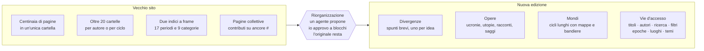
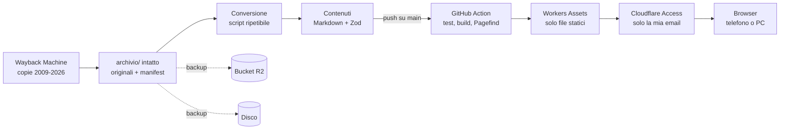

# UtopiaUcronia — analisi e piano di ricostruzione

Aggiornato all'11/11/2026. Il piano operativo in sprint è in [piano-di-sviluppo.md](piano-di-sviluppo.md).

## Obiettivo e contesto

Ricostruire UtopiaUcronia come archivio storico personale, leggibile e ben fatto, su `utopia-ucronia.marcoranica.com`. Il sito **non è pubblico**: sta dietro Cloudflare Access e lo consulto solo io.

- **Fonte:** il vecchio sito su fmboschetto.it/Utopiaucronia, creato nel 2004 con FrontPage. Non ho più accesso al server, quindi il materiale va recuperato dall'esterno.
- **Risultato:** tre versioni dello stesso materiale. Un archivio intatto e immutabile di quello che c'era; una copia consultabile e ripulita delle pagine del 2004; una nuova edizione leggibile, con grafica, navigazione e ricerca moderne.
- **Livello di cura:** lo stesso di uni-portale (uni.marcoranica.com). Grafica con un'identità propria, mobile-first, deploy automatico da GitHub Action.
- **Fuori dallo scopo:** pubblicazione aperta, commenti, invio di nuovi contributi, SEO.

## Il vecchio sito

Nella Wayback Machine ci sono circa 2.640 file validi, di cui circa 676 pagine HTML distinte e 126 PDF. Le copie vanno dal 2009 al 2026. Data di creazione dichiarata in home: 10/11/2004.

| Tipo | File distinti archiviati |
| --- | --- |
| Pagine HTML | ~676 |
| Immagini (GIF, JPEG, PNG, BMP) | ~1.830 |
| PDF | 126 |
| Altro (MIDI, MP3, ZIP, PPT/PPS, DOC, SWF, applet Java) | ~10 |

**Pagine portanti:** home (`index`), Chi siamo (`chisiamo.htm`), Introduzione (`introduzione.htm`), Lista delle ucronie (`lista_ucronie.htm`), Tutti i nostri lavori (`lavori.htm`), Ultime arrivate (`Ultimi.htm`), Uchronies en Français, Ucronías en Español.

**Sottocartelle:** `dipinti_Sandro`, `Dante33`, `Magellania`, `gmr`, `Due_Imperi`, `vssa`, `valentino`, `canale`, `Grande_Messico`, `Grande_Australia`, `uchroniesenfrancais`, `nouivelle_france`, `mondiali2010`, `etruschi`, `egypte`, `Grande_Milano`, `francia_italia`, `ucroniasenespanol`, `keikyo`, `tony`, `odissea_in_america`, `germaniinoriente`, `miniature`, `iperborei`. Fuori dalla cartella c'è anche `../racconti/`, linkata dalla home.

**Tecnologia:**

- Microsoft FrontPage 6.0, codifica ISO-8859-1/Windows-1252, impaginazione a tabelle e ``.
- Script d'epoca: testo che segue il mouse ("UtopiaUcronia, dove tutto è possibile!"), messaggi a scorrimento, data e ora della "nostra Timeline", fase lunare.
- Servizi esterni morti o da togliere: ricerca FreeFind, contatore ShinyStat, MIDI di sottofondo (`bennato_isolachenonce.mid`).
- Nomi di file con maiuscole incoerenti (`Utopiaucronia` / `utopiaucronia`, `Dante33` / `dante33`): il server IIS non distingueva le maiuscole, Cloudflare sì.

**Contenuto tipico di una pagina:** titolo, autore, testo lungo con note, a volte cronologie, mappe e bandiere inventate, ancore interne (`#Pisa`, `#Giustiniano`) per singoli capitoli di pagine collettive.

## Recupero dei contenuti

Si recupera **solo dalla Wayback Machine**. Il server originale risponde "HTTP 999 – AW Special Error" (filtro anti-bot di Aruba) già alla prima richiesta da script: nessuno script lo contatta in automatico. L'obiettivo non è un "archivio completo", impossibile da dimostrare, ma una **raccolta documentata** con copertura misurata.

1. **Indice:** l'API CDX (`web.archive.org/cdx/search/cdx?url=fmboschetto.it/Utopiaucronia/*`) elenca ogni URL archiviato con data, stato e tipo. Si normalizzano gli URL (maiuscole, porta `:80`/`:443`, http/https). Si aggiungono le risorse trovate nei link delle pagine recuperate e `../racconti/`.
2. **Regola sulle date:** per ogni file si prende la copia **valida più recente**, non semplicemente la più recente, e se ne registra la data. Il risultato è una raccolta di pagine di anni diversi, non il sito com'era in un giorno preciso, e la pagina "Storia del sito" lo dice. Per la copia consultabile in `/originale/` si sceglie in più una data di riferimento, così la navigazione resta coerente; le altre date servono solo a colmare i buchi.
3. **Copia valida:** una risposta 200 non basta. Si scartano le pagine d'errore IIS archiviate come buone: la copia del 2026 della Lista delle ucronie, per esempio, è la pagina "Bot blocked" di Aruba. Si scartano anche file troncati, pagine vuote e tipi incoerenti con l'estensione; in quei casi si prova la copia precedente.
4. **Download:** formato grezzo (`/web/<timestamp>id_/<url>`), lotti da 10, una richiesta alla volta, pause tra i lotti. Lo script è riprendibile.
5. **Cosa è "originale":** il contenuto del file com'era sul server. Il gzip lo aggiunge la Wayback durante il trasferimento: si decomprime, l'hash SHA-256 si calcola sul contenuto decompresso e il manifest annota che la risposta era compressa.
6. **Esiti:** ogni URL ha un esito nel manifest: `recuperato`, `recuperato da copia precedente`, `tentativo fallito` (da ripetere), `mancante` (nessuna copia valida in nessuna data). Un tentativo fallito non è mai confuso con un file perso.
7. **Rapporto di copertura** (`archivio/copertura.md`): percentuale di URL recuperati per tipo, risorse richiamate dalle pagine e non recuperate, pagine che rimandano a materiale mancante, distribuzione delle date delle copie, limiti dichiarati.

Per i buchi si possono provare a mano altre fonti (archive.today, cache dei motori di ricerca). Quello che resta mancante è segnalato nella nuova edizione, non nascosto.

## Nuova organizzazione

Il nuovo sito non ricalca file e cartelle del 2004: si organizza per contenuto. I percorsi originali sopravvivono solo nell'archivio intatto, in `/originale/` e nel campo `origine` di ogni contenuto.

**Com'era ordinato il vecchio sito** (letto dagli indici archiviati):

- **Lista delle ucronie:** un catalogo di spunti brevi, un paragrafo ciascuno con l'autore, diviso in 17 periodi: dalle "Ucronie preistoriche" a quelle "del presente e del futuro", più "fantastiche e fantaletterarie". Sono circa 20 pagine dentro un frameset.
- **Tutti i nostri lavori:** le opere complete, in 9 categorie diverse dai 17 periodi (antiche, romane, medievali, moderne, 1860–1940, 1940–1960, post 1960, Fantastorie, Utopie e racconti).
- **Pagine collettive:** una pagina con contributi di autori diversi, raggiungibili per ancora (`spotthePOD.htm#NONO`, `cinque_rep_marinare.htm#Pisa`).
- **Opere spezzate:** un testo su più file (`25071943.htm`, `25071943_2.htm`, `25071943_doppio.htm`).
- **Cartelle:** a volte di un autore, a volte di un ciclo con mappe e bandiere.

**I tre livelli di contenuto:**

| Livello | Cos'è | Da dove viene | URL |
| --- | --- | --- | --- |
| Divergenza | uno spunto "E se…" in un paragrafo, con autore | voci della Lista delle ucronie, contributi brevi delle pagine collettive | `/divergenze/<slug>` |
| Opera | un testo completo: ucronia, utopia, racconto, cronologia, saggio | pagine dei lavori; i file spezzati riuniti in capitoli | `/opere/<slug>` |
| Mondo | un ciclo di molte pagine con mappe, bandiere, cronologie | le cartelle che risultano cicli (Magellania, Grande Messico, Due Imperi: da verificare una per una) | `/mondi/<slug>/<capitolo>` |

Una divergenza rimanda all'opera che la sviluppa, se c'è. Un'opera può far parte di un mondo.

**Le vie d'accesso.** La base sono titoli, autori, ricerca e filtri, che funzionano da soli anche con metadati incompleti. Sopra:

- **Tempo:** epoche e albero delle divergenze. Le epoche partono dai 17 periodi della vecchia Lista, ridefiniti come intervalli di anni, più "Fuori dal tempo" per le ucronie fantastiche e fantaletterarie.
- **Luoghi:** area geografica, con una mappa.
- **Temi:** etichette trasversali (Roma, Napoleone, Risorgimento, guerre mondiali, religioni, scienza…) proposte dall'agente.
- **Autori:** una pagina per autore o pseudonimo, in ordine di contributi come la vecchia "Classifica degli autori".

La lingua (italiano, francese, spagnolo) diventa un filtro, non una sezione a parte.

**Come si decide: la mappa di riorganizzazione.**

1. Dopo il recupero, un agente legge ogni file e scrive `contenuti/mappa.yaml`. Per ogni vecchio file propone un'azione: `opera`, `dividi` (pagina collettiva in più contenuti), `unisci` (file spezzati), `mondo`, `indice` (elenchi: servono solo come fonte di metadati) o `scarta` (frame, titoli, pagine tecniche).
2. Rivedo le proposte a blocchi di 20 in una pagina `/revisione`, che esiste solo in sviluppo (`pnpm dev`): accetto, correggo o rimando. Le decisioni tornano nel file.
3. La conversione segue la mappa. Ciò che non ho ancora rivisto esce comunque, segnato "da verificare".
4. Indici a frame e pagine tecniche non diventano pagine nuove: restano consultabili in `/originale/`.

Quante divergenze, opere e mondi ci siano davvero si saprà solo dopo il recupero.

## Modello dei contenuti

Si tengono distinte le cose che esistono nella fonte da quelle che decidiamo noi. Markdown resta il formato di arrivo, ma un vincolo del filesystem non diventa una scelta editoriale.

| Entità | Cos'è | Dove sta |
| --- | --- | --- |
| Documento | un file originale recuperato, con data della copia e hash | `archivio/manifest.json` |
| Contenuto | una divergenza, un'opera o un capitolo di un mondo | un file Markdown in `src/content/` |
| Contributo | un intervento firmato dentro un contenuto: risposta, commento, aggiunta successiva | una sezione del contenuto, con il suo autore |

Un documento può alimentare più contenuti e un contenuto può venire da più documenti: il legame sta nella mappa di riorganizzazione. Tabelle, note e immagini restano nel testo. Quello che Markdown non rende bene, come tabelle impaginate o mappe cliccabili, resta HTML ripulito dentro il file. La conversione è uno script ripetibile e le correzioni a mano stanno in un file a parte, così una nuova conversione non le cancella.

**Conversione** (`scripts/converti.ts`):

- da Windows-1252 a UTF-8, con correzione delle entità (`&#146;`, `« »`);
- da HTML FrontPage a Markdown: via script, ``, tabelle di impaginazione e stili in linea; restano titoli, paragrafi, corsivi, note, tabelle vere, immagini e ancore;
- link interni riscritti verso i nuovi URL, ancore comprese; link esterni morti segnalati;
- email tolte, `mailto:` resi come testo semplice;
- immagini con lo stesso hash unificate, PDF e allegati copiati così come sono;
- ogni pagina convertita male finisce in `revisione.md`.

**Metadati di un contenuto:**

| Campo | Natura | Contenuto |
| --- | --- | --- |
| `livello` | struttura | divergenza, opera, mondo |
| `titolo` | fonte | `<title>`, primo titolo, o prime parole dello spunto |
| `autori` | fonte | nomi o pseudonimi, mai email |
| `pubblicata` | fonte | data dalle Ultime arrivate, se nota |
| `lingua` | fonte | it, fr, es |
| `divergenze` | interpretazione | elenco di anni (negativo = a.C.), anche vuoto |
| `epoche` | interpretazione | uno o più dei 17 periodi della vecchia Lista ridefiniti in anni, più Fuori dal tempo |
| `luoghi` | interpretazione | elenco di aree |
| `temi` | interpretazione | elenco chiuso di etichette |
| `tipo` | interpretazione | ucronia, utopia, racconto, cronologia, saggio, gioco |
| `mondo` | struttura | slug del mondo, se ne fa parte |
| `sviluppata_in` | struttura | slug dell'opera che sviluppa la divergenza |
| `contributi` | struttura | autori e posizione degli interventi nel testo |
| `allegati` | fonte | PDF e altri file |
| `origine` | fonte | documenti d'origine (anche più d'uno, con ancora) e data della copia |

**Regole di classificazione:**

- Ogni campo di interpretazione ammette "sconosciuto". Catalogo, filtri e ricerca funzionano anche con metadati incompleti.
- Un contenuto può avere più divergenze, epoche e luoghi; un'utopia può non avere nessuna divergenza.
- Ogni interpretazione registra chi l'ha data (agente o io), lo stato (proposta o approvata) e una riga di motivazione che cita il testo.
- La classificazione cresce per gradi: nessuno sprint aspetta che sia completa.

**URL nuovi:** scelti per contenuto, non per file: `/divergenze/<slug>`, `/opere/<slug>`, `/mondi/<slug>/<capitolo>`, `/epoche/<slug>`, `/luoghi/<slug>`, `/temi/<slug>`, `/autori/<slug>`. Gli slug nascono dal titolo, non dal vecchio nome del file. Niente redirect dai vecchi percorsi: il sito è privato e nessun link esterno ci punta. Il vecchio percorso resta nel campo `origine` e porta alla pagina com'era in `/originale/`.

**Email e dati personali:** il vecchio sito mostrava in chiaro le email degli autori. Non compaiono in nessuna vista consultabile, né nella nuova edizione né nella copia ripulita in `/originale/`: restano solo nomi e pseudonimi, e i link `mailto:` diventano testo semplice. Le conserva solo l'archivio intatto, che il sito non serve.

## Direzione grafica

La metafora proposta è la **linea del tempo che si biforca**. La storia reale è una linea sottile, e ogni opera è un ramo che si stacca nell'anno della sua divergenza. La metafora serve solo dove informa.

- **Albero delle divergenze:** la mappa dei rami dall'antichità al futuro, densa dove le ucronie sono tante (Novecento, Roma). Toccando un ramo si apre l'opera.
- **Pagina di lettura:** in testa la divergenza ("E se nel 1848…"), poi autore, mondo, allegati e link alla pagina d'origine. Testo in colonna da libro (65–70 caratteri), note cliccabili, indice laterale per i testi lunghi.
- **Catalogo:** filtri per epoca, luogo, tema, tipo, autore e lingua, che si combinano e restano nell'URL.
- **Caratteri:** un serif da lettura per i testi lunghi e un solo sans per l'interfaccia, entrambi in locale con `@fontsource`. La scelta precisa si fa nei prototipi.
- **Temi:** chiaro e scuro, mobile-first, navigazione inferiore su telefono come in uni-portale.
- **Omaggio al vecchio sito:** una pagina "Storia del sito" con logo, anfora, sfondo originale, la frase "dove tutto è possibile!" e una ricostruzione della home del 2004 in un riquadro.

L'albero è una vista in più del catalogo, non la base della navigazione: titoli, autori, ricerca e filtri funzionano da soli. Si prova presto con dati veri e con i casi difficili: date mancanti, titoli lunghi, decine di opere nello stesso secolo, schermo del telefono. La home del 2004 nella Storia del sito è una ricostruzione scritta da noi, non la pagina originale con i suoi script.

**Metodo, come in uni-portale:**

1. Si carica la skill `frontend-design` (copiata da `uni-portale/.claude/skills/`) e si evitano i cliché che elenca: fondo crema, monospazio per i dati, una parola evidenziata nel titolo, etichette sopra ogni titolo, tutto in card uguali.
2. Si preparano due direzioni a confronto su lettura e catalogo, con contenuti veri e non lorem ipsum.
3. Scelgo io, e la direzione approvata finisce in `src/styles/tokens.css` e in `CLAUDE.md`.

## Architettura e deploy

Il sito è interamente statico: niente SSR, niente database, nessun codice lato server. Cloudflare Access lo chiude davanti, come uni-portale.

| Pezzo | Scelta |
| --- | --- |
| Framework | Astro 7 in output statico, Content Collections con schema Zod |
| Ricerca | Pagefind, indice generato dopo la build, in italiano, francese e spagnolo; solo nuova edizione |
| Hosting | Cloudflare Workers con soli asset statici: `wrangler.jsonc` con `assets.directory: ./dist`, senza `main` |
| Dominio | rotta `utopia-ucronia.marcoranica.com` con `custom_domain: true`; `workers_dev` e `preview_urls` spenti |
| Accesso | applicazione Cloudflare Access sul sottodominio, policy con la sola mia email, sessione lunga |
| Vecchi percorsi | nessun redirect: restano nel campo `origine` e in `/originale/` |
| Repository | GitHub privato `utopia-ucronia`, binari in Git LFS |
| CI | `.github/workflows/deploy-sito.yml`: checkout, pnpm, Node 24, test, build, controllo dei link, `wrangler deploy`, sincronizzazione R2 |
| Segreti | `CLOUDFLARE_API_TOKEN`, `CLOUDFLARE_ACCOUNT_ID`, gli stessi di uni-portale se il token vale per tutto l'account |
| Dipendenze | ultime versioni stabili all'avvio, poi bloccate dal lockfile di pnpm; aggiornamenti deliberati, uno alla volta, con build e test |

**Limiti da rispettare:** Workers Assets accetta fino a 20.000 file per versione e 25 MiB per file. Un PDF più grande va su R2.

**Tre versioni dello stesso materiale**, con trattamenti diversi:

| Versione | Cosa contiene | Dove sta | Servita dal sito |
| --- | --- | --- | --- |
| Archivio intatto | i file com'erano, mai modificati, email comprese | `archivio/originale/`, repository e backup | no |
| Copia consultabile | le pagine del 2004 alla data di riferimento, ripulite: niente script, eventi HTML, iframe, form, contatori, MIDI, risorse esterne, email; link riscritti verso l'interno | generata in build | sì, in `/originale/`, con una Content Security Policy che vieta gli script |
| Nuova edizione | i contenuti convertiti e riorganizzati | `src/content/` | sì |

La ricerca indicizza solo la nuova edizione: la copia consultabile è esclusa, così ogni risultato non compare due volte. Da ogni contenuto un link porta alla sua pagina d'origine.

**Backup e ripristino.** Hash e manifest rilevano una modifica, ma non riportano indietro un file perso. L'archivio intatto sta in tre posti:

1. il repository privato su GitHub, con i file binari pesanti in Git LFS;
2. un bucket R2 su Cloudflare, aggiornato dalla GitHub Action a ogni modifica di `archivio/`;
3. una copia su un disco mio, aggiornata a mano a ogni recupero.

Aggiornamento del proprietario dell’11/11/2026: la terza copia verrà salvata sul suo drive in futuro, a sua cura. Rimane prevista e non risulta eseguita, ma è rinviata e non blocca la prosecuzione dello sviluppo. Non si richiede accesso al drive per lavorare al progetto.

Il ripristino si prova davvero: da un clone pulito o dal solo bucket R2 si ricostruisce l'archivio, si verificano tutti gli hash e si ricompila il sito. La prova ha un comando (`pnpm ripristino:prova`) e chiude lo sprint delle fondamenta.

## Fasi di lavoro

Si parte dimostrando che il materiale si recupera e si converte bene, poi si costruisce una prima versione utile alla lettura; classificazione e grafica crescono intorno a quella. Il dettaglio è in [piano-di-sviluppo.md](piano-di-sviluppo.md).

| Sprint | Risultato | Fatto quando |
| --- | --- | --- |
| S0 Prova e fondamenta | una decina di file rappresentativi portati dal recupero alla lettura nel browser; repository, deploy privato, backup | il campione si legge bene; il sottodominio chiede il login; la prova di ripristino riesce |
| S1 Recupero | inventario, regola sulle date, manifest, rapporto di copertura | ogni URL ha un esito; ogni risorsa richiamata è recuperata o segnalata; copertura in percentuale |
| S2 Conversione | modello verificato sui casi reali, mappa di riorganizzazione proposta, correzioni persistenti | schema senza errori; zero link irrisolti senza spiegazione; confronto superato su 30 contenuti |
| S3 Prima versione utile | lettura, catalogo semplice, ricerca, link alla fonte | dal telefono ritrovo un testo ricordandone una frase |
| S4 Edizione completa | revisione progressiva della classificazione, autori, mondi, temi, grafica definitiva | direzione approvata; filtri che funzionano anche con metadati parziali |
| S5 Viste speciali | albero delle divergenze, copia consultabile in `/originale/` | albero leggibile anche nei casi difficili; nessuno script nelle pagine originali servite |
| S6 Rifinitura | verifiche finali, nuova prova di ripristino | giro completo da telefono; ripristino da zero riuscito |

**Il confronto** tra originale e conversione segue una lista fissa: titoli, paragrafi, immagini, note, tabelle, accenti, attribuzioni. **Un link irrisolto** è accettabile solo se spiegato: un errore di conversione si corregge, una lacuna dell'archivio resta visibile come tale. **Accessibilità e controlli della conversione** partono dal primo componente, non nell'ultimo sprint; contano più fedeltà dei testi, ricerca, uso da tastiera e leggibilità del punteggio Lighthouse.

## Rischi e decisioni aperte

Il rischio principale è che la Wayback non abbia tutto, o che abbia salvato come buone pagine d'errore. Per questo la prova sul campione e il rapporto di copertura vengono prima di qualsiasi lavoro di grafica.

| Rischio | Effetto | Contromisura |
| --- | --- | --- |
| Pagine d'errore salvate come buone (la Lista delle ucronie del 2026 è la pagina "Bot blocked") | testo sbagliato preso per originale | controlli sul contenuto, si scende alla copia valida precedente |
| Pagine o immagini mai archiviate | contenuti incompleti | esito `mancante` nel manifest, lacuna segnalata nella nuova edizione, ricerca a mano su altri archivi |
| Copie di anni diversi | navigazione e versioni incoerenti | regola sulle date: copia valida più recente per file, data di riferimento per `/originale/`, data di ogni copia nel campo `origine` |
| Codifiche miste e HTML FrontPage malformato | caratteri sbagliati, testo perso | parser tollerante, lista di confronto fissa, prova sul campione in S0 |
| Strutture che non stanno in un file Markdown | perdita di relazioni tra testi | entità documento, contenuto, contributo; HTML ripulito dove Markdown non basta |
| Maiuscole incoerenti nei nomi di file | link interni irrisolti | nell'archivio un file con più varianti si salva una volta; i link si risolvono senza distinguere le maiuscole |
| Perdita dell'archivio (disco, cancellazione, errore) | materiale perso per sempre | tre copie (GitHub, R2, disco) e prova di ripristino in S0 e S6 |
| Script e risorse esterne nelle pagine originali servite | codice del 2004 eseguito nel sito | copia ripulita, Content Security Policy senza script |
| Sito raggiungibile senza Access | archivio esposto | `workers_dev` e `preview_urls` spenti, prova da browser anonimo in S0 |
| Classificazione come collo di bottiglia | sprint bloccati dalla revisione manuale | valori sconosciuti ammessi, revisione progressiva a blocchi di 20, nessuno sprint aspetta la classificazione completa |
| Albero illeggibile con dati veri | navigazione confusa, soprattutto da telefono | albero come vista in più, prova presto con i casi difficili |
| Archivio troppo pesante per Git o per Workers | push lenti, deploy rifiutato | Git LFS per i binari, R2 per i file oltre 25 MiB |

**Da decidere:**

- [ ] Archivio congelato o vivo? Copia storica e basta, oppure poter aggiungere opere nuove in futuro.
- [ ] Data di riferimento per la copia consultabile in `/originale/`: si sceglie dopo il rapporto di copertura, guardando quale anno ha più copie valide.
- [ ] Disco per la terza copia di backup.
- [ ] Coppia di caratteri, da scegliere nei prototipi.
- [ ] Durata della sessione di Access (proposta: 30 giorni, come comodità da telefono).

**Già deciso l'11/11/2026, dopo una revisione critica del piano:** recupero solo dalla Wayback; email tolte da tutte le viste consultabili; copia consultabile in `/originale/`, ripulita; prova sul campione e backup prima di tutto il resto; ricerca nella prima versione utile; albero delle divergenze come vista in più; versioni bloccate dal lockfile dopo l'avvio.
