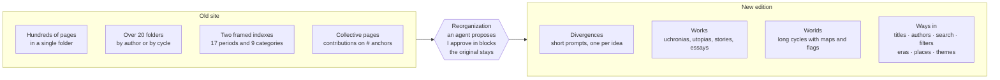
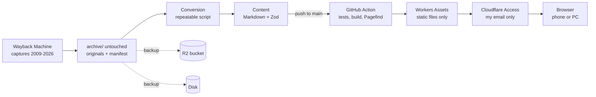

# UtopiaUcronia — analysis and reconstruction plan

Updated 12/11/2026. The sprint-by-sprint operational plan is in [development-plan.md](development-plan.md).

## Goal and context

Rebuild UtopiaUcronia as a personal historical archive, readable and well made, at `utopia-ucronia.marcoranica.com`. The site is **not public**: it sits behind Cloudflare Access and only I use it.

- **Source:** the old site at fmboschetto.it/Utopiaucronia, created in 2004 with FrontPage. I no longer have access to the server, so the material has to be recovered from outside.
- **Result:** three versions of the same material. An untouched, immutable archive of what was there; a browsable, cleaned-up copy of the 2004 pages; a readable new edition with modern design, navigation and search.
- **Level of care:** the same as uni-portale (uni.marcoranica.com). A design with its own identity, mobile-first, automatic deploy from a GitHub Action.
- **Out of scope:** open publication, comments, submission of new contributions, SEO.

## The old site

The Wayback Machine holds about 2,640 valid files, including about 676 distinct HTML pages and 126 PDFs. The captures range from 2009 to 2026. Creation date stated on the home page: 10/11/2004.

| Type | Distinct archived files |
| --- | --- |
| HTML pages | ~676 |
| Images (GIF, JPEG, PNG, BMP) | ~1,830 |
| PDF | 126 |
| Other (MIDI, MP3, ZIP, PPT/PPS, DOC, SWF, Java applets) | ~10 |

**Main pages:** home (`index`), Chi siamo (about us, `chisiamo.htm`), Introduzione (introduction, `introduzione.htm`), the "Lista delle ucronie" (list of uchronias, `lista_ucronie.htm`), "Tutti i nostri lavori" (all our works, `lavori.htm`), "Ultime arrivate" (latest arrivals, `Ultimi.htm`), Uchronies en Français, Ucronías en Español.

**Subfolders:** `dipinti_Sandro`, `Dante33`, `Magellania`, `gmr`, `Due_Imperi`, `vssa`, `valentino`, `canale`, `Grande_Messico`, `Grande_Australia`, `uchroniesenfrancais`, `nouivelle_france`, `mondiali2010`, `etruschi`, `egypte`, `Grande_Milano`, `francia_italia`, `ucroniasenespanol`, `keikyo`, `tony`, `odissea_in_america`, `germaniinoriente`, `miniature`, `iperborei`. Outside the folder there is also `../racconti/`, linked from the home page.

**Technology:**

- Microsoft FrontPage 6.0, ISO-8859-1/Windows-1252 encoding, table and `` layout.
- Period scripts: text following the mouse ("UtopiaUcronia, dove tutto è possibile!"), scrolling messages, date and time of the "nostra Timeline" (our Timeline), moon phase.
- Dead external services, or ones to remove: FreeFind search, ShinyStat counter, background MIDI (`bennato_isolachenonce.mid`).
- File names with inconsistent case (`Utopiaucronia` / `utopiaucronia`, `Dante33` / `dante33`): the IIS server was case-insensitive, Cloudflare is not.

**Typical page content:** title, author, long text with notes, sometimes chronologies, invented maps and flags, internal anchors (`#Pisa`, `#Giustiniano`) for individual chapters of collective pages.

## Content recovery

Recovery uses **only the Wayback Machine**. The original server answers "HTTP 999 – AW Special Error" (Aruba's anti-bot filter) from the very first scripted request: no script contacts it automatically. The goal is not a "complete archive", which cannot be proven, but a **documented collection** with measured coverage.

1. **Index:** the CDX API (`web.archive.org/cdx/search/cdx?url=fmboschetto.it/Utopiaucronia/*`) lists every archived URL with date, status and type. URLs are normalized (case, port `:80`/`:443`, http/https). Resources found in the links of recovered pages, and `../racconti/`, are added.
2. **Date rule:** for each file we take the **most recent valid capture**, not simply the most recent one, and record its date. The result is a collection of pages from different years, not the site as it was on a given day, and the "Site history" page says so. For the browsable copy in `/original/` we also choose a reference date, so navigation stays consistent; the other dates only fill the gaps.
3. **Valid capture:** a 200 response is not enough. IIS error pages archived as good are discarded: the 2026 capture of the "Lista delle ucronie", for example, is Aruba's "Bot blocked" page. Truncated files, empty pages and types inconsistent with the extension are discarded too; in those cases the previous capture is tried. If no capture is clean (13/11/2026), the most recent copy that is still the right kind of file and not an error page is kept with its `defects` listed in the manifest and in `coverage.md` (for example a GIF saved as `.jpg`, or a page without its closing tags on the server itself): an incomplete original is preserved, not counted as lost. Origin downloads use this lenient check directly, since `fetch` already rejects bodies shorter than `Content-Length`.
4. **Download:** raw format (`/web/<timestamp>id_/<url>`), batches of 10, one request at a time, pauses between batches. The script is resumable.
5. **What "original" means:** the content of the file as it was on the server. Gzip is added by the Wayback during transfer: it is decompressed, the SHA-256 hash is computed on the decompressed content and the manifest notes that the response was compressed.
6. **Outcomes:** every URL has an outcome in the manifest: `recovered`, `recovered from earlier copy`, `failed attempt` (to retry), `missing` (no valid capture at any date). A failed attempt is never confused with a lost file.
7. **Coverage report** (`archive/coverage.md`): percentage of URLs recovered by type, resources referenced by pages and not recovered, pages pointing to missing material, distribution of capture dates, stated limits.

For the gaps, other sources can be tried by hand (archive.today, search engine caches). Whatever remains missing is flagged in the new edition, not hidden.

## New organization

The new site does not mirror the 2004 files and folders: it is organized by content. The original paths survive only in the untouched archive, in `/original/` and in the `sources` field of each content item.

**How the old site was ordered** (read from the archived indexes):

- **"Lista delle ucronie":** a catalog of short prompts, one paragraph each with its author, divided into 17 periods: from the "Ucronie preistoriche" (prehistoric uchronias) to those "del presente e del futuro" (of the present and the future), plus "fantastiche e fantaletterarie" (fantasy and literary-fantasy). About 20 pages inside a frameset.
- **"Tutti i nostri lavori":** the complete works, in 9 categories different from the 17 periods (ancient, Roman, medieval, modern, 1860–1940, 1940–1960, post 1960, Fantastorie, Utopias and stories).
- **Collective pages:** a page with contributions from different authors, reached by anchor (`spotthePOD.htm#NONO`, `cinque_rep_marinare.htm#Pisa`).
- **Split works:** one text across several files (`25071943.htm`, `25071943_2.htm`, `25071943_doppio.htm`).
- **Folders:** sometimes of one author, sometimes of a cycle with maps and flags.

**The three content levels:**

| Level | What it is | Where it comes from | URL |
| --- | --- | --- | --- |
| Divergence | a one-paragraph "What if…" prompt, with its author | entries of the "Lista delle ucronie", short contributions on collective pages | `/divergences/<slug>` |
| Work | a complete text: uchronia, utopia, story, chronology, essay | the works pages; split files reunited as chapters | `/works/<slug>` |
| World | a cycle of many pages with maps, flags, chronologies | the folders that turn out to be cycles (Magellania, Grande Messico, Due Imperi: to be checked one by one) | `/worlds/<slug>/<chapter>` |

A divergence links to the work that develops it, if there is one. A work can be part of a world.

**The ways in.** The base is titles, authors, search and filters, which work on their own even with incomplete metadata. On top of that:

- **Time:** eras and the divergence tree. Eras start from the 17 periods of the old Lista, redefined as year ranges, plus "Outside time" for fantasy and literary-fantasy uchronias.
- **Places:** geographic area, with a map.
- **Themes:** cross-cutting labels (Rome, Napoleon, Risorgimento, world wars, religions, science…) proposed by the agent.
- **Authors:** one page per author or pseudonym, ordered by number of contributions like the old "Classifica degli autori" (author ranking).

Language (Italian, French, Spanish) becomes a filter, not a separate section.

**How decisions are made: the reorganization map.**

1. After recovery, an agent reads each file and writes `data/map.yaml`. For each old file it proposes an action: `work`, `split` (collective page into several content items), `merge` (split files), `world`, `index` (lists: used only as a metadata source) or `discard` (frames, title pages, technical pages).
2. I review the proposals in blocks of 20 on a `/review` page that exists only in development (`pnpm dev`): accept, correct or postpone. Decisions go back into the file.
3. Conversion follows the map. What I haven't reviewed yet is published anyway, marked "to verify".
4. Framed indexes and technical pages don't become new pages: they remain browsable in `/original/`.

How many divergences, works and worlds there really are will only be known after recovery.

## Content model

What exists in the source is kept distinct from what we decide. Markdown remains the target format, but a filesystem constraint does not become an editorial choice.

| Entity | What it is | Where it lives |
| --- | --- | --- |
| Document | a recovered original file, with capture date and hash | `archive/manifest.json` |
| Content item | a divergence, a work or a chapter of a world | a Markdown file in `src/content/` |
| Contribution | a signed piece inside a content item: reply, comment, later addition | a section of the content item, with its author |

A document can feed several content items and a content item can come from several documents: the link lives in the reorganization map. Tables, notes and images stay in the text. What Markdown renders poorly, like laid-out tables or clickable maps, stays as cleaned HTML inside the file. Conversion is a repeatable script and manual corrections live in a separate file, so a new conversion does not erase them.

**Conversion** (`scripts/convert.ts`):

- from Windows-1252 to UTF-8, fixing entities (`&#146;`, `« »`);
- from FrontPage HTML to Markdown: scripts, ``, layout tables and inline styles go; headings, paragraphs, italics, notes, real tables, images and anchors stay;
- internal links rewritten to the new URLs, anchors included; dead external links flagged;
- emails removed, `mailto:` rendered as plain text;
- images with the same hash merged, PDFs and attachments copied as they are;
- every badly converted page ends up in `review.md`.

**Content item metadata:**

| Field | Nature | Content |
| --- | --- | --- |
| `level` | structure | divergence, work, world |
| `title` | source | `<title>`, first heading, or first words of the prompt |
| `authors` | source | names or pseudonyms, never emails |
| `published` | source | date from the "Ultime arrivate", if known |
| `language` | source | it, fr, es |
| `divergences` | interpretation | list of years (negative = BC), possibly empty |
| `eras` | interpretation | one or more of the 17 periods of the old Lista redefined as years, plus Outside time |
| `places` | interpretation | list of areas |
| `themes` | interpretation | closed list of labels |
| `kind` | interpretation | uchronia, utopia, story, chronology, essay, game |
| `world` | structure | slug of the world, if it belongs to one |
| `developed_in` | structure | slug of the work that develops the divergence |
| `contributions` | structure | authors and position of the contributions in the text |
| `attachments` | source | PDFs and other files |
| `sources` | source | source documents (possibly more than one, with anchor) and capture date |

**Classification rules:**

- Every interpretation field accepts `unknown`. Catalog, filters and search work even with incomplete metadata.
- A content item can have several divergences, eras and places; a utopia may have no divergence at all.
- Every interpretation records who gave it (agent or me), its state (proposed or approved) and one line of reasoning quoting the text.
- Classification grows step by step: no sprint waits for it to be complete.

**New URLs:** chosen by content, not by file: `/divergences/<slug>`, `/works/<slug>`, `/worlds/<slug>/<chapter>`, `/eras/<slug>`, `/places/<slug>`, `/themes/<slug>`, `/authors/<slug>`. Slugs come from the title, not from the old file name. No redirects from the old paths: the site is private and no external link points to it. The old path stays in the `sources` field and leads to the page as it was in `/original/`.

**Emails and personal data:** the old site showed authors' emails in plain text. They appear in no browsable view, neither in the new edition nor in the cleaned copy in `/original/`: only names and pseudonyms remain, and `mailto:` links become plain text. Only the untouched archive keeps them, and the site does not serve it.

## Design direction

The owner chose the restrained branching-tree direction on 13 November 2026 after rejecting an ornate editorial prototype and a version too close to uni-portale. The implemented palette is slate blue, warm white and copper (`src/styles/tokens.css`). Titillium Web is served locally for the interface; Georgia is the reading face. The branch mark appears in navigation, and the tree is the single prominent graphic on the sample catalog and the three-work preview. The actual catalog and reading pages now share these tokens in light and dark themes. The compact top navigation remains visible on phones; a bottom bar would duplicate the reference project without helping this small archive navigation.

The proposed metaphor is the **forking timeline**. Real history is a thin line, and every work is a branch that leaves it in the year of its divergence. The metaphor is used only where it informs.

- **Divergence tree:** the map of branches from antiquity to the future, dense where uchronias are many (twentieth century, Rome). Tapping a branch opens the work.
- **Reading page:** at the top the divergence ("What if in 1848…"), then author, world, attachments and a link to the source page. Text in a book-like column (65–70 characters), clickable notes, side table of contents for long texts.
- **Catalog:** filters by era, place, theme, kind, author and language, which combine and stay in the URL.
- **Typefaces:** a reading serif for long texts and a single sans for the interface, both served locally with `@fontsource`. The exact choice is made in the prototypes.
- **Themes:** light and dark, mobile-first, compact top navigation on phones.
- **Tribute to the old site:** a "Site history" page with logo, amphora, original background, the phrase "dove tutto è possibile!" and a reconstruction of the 2004 home page in a frame.

The tree is an extra view of the catalog, not the basis of navigation: titles, authors, search and filters work on their own. It is tested early with real data and the hard cases: missing dates, long titles, dozens of works in the same century, a phone screen. The 2004 home page in the Site history is a reconstruction written by us, not the original page with its scripts.

**Method, as in uni-portale:**

1. Load the `frontend-design` skill (copied from `uni-portale/.claude/skills/`) and avoid the clichés it lists: cream background, monospace for data, one highlighted word in the title, labels above every heading, everything in identical cards.
2. Prepare two competing directions for reading and catalog, with real content, not lorem ipsum.
3. I choose, and the approved direction goes into `src/styles/tokens.css` and `CLAUDE.md`.

## Architecture and deploy

The site is entirely static: no SSR, no database, no server-side code. Cloudflare Access closes it off in front, as with uni-portale.

| Piece | Choice |
| --- | --- |
| Framework | Astro 7 with static output, Content Collections with Zod schema |
| Search | Pagefind, index generated after the build, in Italian, French and Spanish; new edition only |
| Hosting | Cloudflare Workers with static assets only: `wrangler.jsonc` with `assets.directory: ./dist`, no `main` |
| Domain | route `utopia-ucronia.marcoranica.com` with `custom_domain: true`; `workers_dev` and `preview_urls` off |
| Access | Cloudflare Access application on the subdomain, policy with the three addresses explicitly chosen by the owner, long session |
| Old paths | no redirects: they stay in the `sources` field and in `/original/` |
| Repository | private GitHub `utopia-ucronia`, binaries in Git LFS |
| CI | `.github/workflows/deploy-site.yml`: checkout, pnpm, Node 24, tests, build, link check, `wrangler deploy`, R2 sync |
| Secrets | `CLOUDFLARE_API_TOKEN`, `CLOUDFLARE_ACCOUNT_ID`, the same as uni-portale if the token covers the whole account |
| Dependencies | latest stable versions at start, then locked by the pnpm lockfile; deliberate updates, one at a time, with build and tests |

**Limits to respect:** Workers Assets accepts up to 20,000 files per version and 25 MiB per file. A larger PDF goes to R2.

**Three versions of the same material**, treated differently:

| Version | What it contains | Where it lives | Served by the site |
| --- | --- | --- | --- |
| Untouched archive | the files as they were, never modified, emails included | `archive/original/`, repository and backups | no |
| Browsable copy | the 2004 pages at the reference date, cleaned: no scripts, HTML event attributes, iframes, forms, counters, MIDI, external resources, emails; links rewritten to stay inside | generated at build time | yes, in `/original/`, with a Content Security Policy that forbids scripts |
| New edition | the converted and reorganized content | `src/content/` | yes |

Search indexes only the new edition: the browsable copy is excluded, so no result appears twice. From every content item a link leads to its source page.

**Backup and restore.** Hashes and manifest detect a change, but they don't bring back a lost file. The untouched archive is currently in the private GitHub repository, with heavy binary files in Git LFS. The owner paused R2 uploads of `original/` on 13/11/2026 and the bucket was emptied. The additional copy on the owner's disk remains planned.

Owner update of 11/11/2026: the third copy will be saved to the owner's drive in the future, by the owner. It remains planned and is not done, but it is postponed and does not block development. No drive access is required to work on the project.

The restore from a clean clone was tested: the archive was rebuilt, all hashes verified and the site rebuilt. The R2 restore was tested before uploads were paused; it is unavailable while the bucket is empty.

## Work phases

We start by proving that the material can be recovered and converted well, then build a first version useful for reading; classification and design grow around it. Details in [development-plan.md](development-plan.md).

| Sprint | Result | Done when |
| --- | --- | --- |
| S0 Trial and foundations | about ten representative files taken from recovery to reading in the browser; repository, private deploy, backups | the sample reads well; the subdomain asks for login; the restore test succeeds |
| S1 Recovery | inventory, date rule, manifest, coverage report | every URL has an outcome; every referenced resource is recovered or flagged; coverage as a percentage |
| S2 Conversion | model verified on real cases, proposed reorganization map, persistent corrections | schema without errors; zero unexplained unresolved links; comparison passed on 30 content items |
| S3 First useful version | reading, simple catalog, search, link to the source | from the phone I find a text by remembering one sentence of it |
| S4 Complete edition | progressive review of classification, authors, worlds, themes, final design | direction approved; filters that work even with partial metadata |
| S5 Special views | divergence tree, browsable copy in `/original/` | tree readable even in hard cases; no scripts in the served original pages |
| S6 Polish | final checks, new restore test | full round from the phone; restore from scratch succeeds |

**The comparison** between original and conversion follows a fixed checklist: headings, paragraphs, images, notes, tables, accents, attributions. **An unresolved link** is acceptable only if explained: a conversion error is fixed, an archive gap stays visible as such. **Accessibility and conversion checks** start with the first component, not in the last sprint; fidelity of the texts, search, keyboard use and readability matter more than the Lighthouse score.

## Risks and open decisions

The main risk is that the Wayback doesn't have everything, or that it saved error pages as good ones. That's why the sample trial and the coverage report come before any design work.

| Risk | Effect | Countermeasure |
| --- | --- | --- |
| Error pages saved as good (the 2026 "Lista delle ucronie" is the "Bot blocked" page) | wrong text taken as original | content checks, fall back to the previous valid capture |
| Pages or images never archived | incomplete content | `missing` outcome in the manifest, gap flagged in the new edition, manual search in other archives |
| Captures from different years | inconsistent navigation and versions | date rule: most recent valid capture per file, reference date for `/original/`, date of each capture in the `sources` field |
| Mixed encodings and malformed FrontPage HTML | wrong characters, lost text | tolerant parser, fixed comparison checklist, sample trial in S0 |
| Structures that don't fit in one Markdown file | lost relationships between texts | document, content item and contribution entities; cleaned HTML where Markdown isn't enough |
| Inconsistent case in file names | unresolved internal links | in the archive a file with several variants is saved once; links are resolved case-insensitively |
| Loss of the archive (disk, deletion, mistake) | material lost forever | three copies (GitHub, R2, disk) and restore test in S0 and S6 |
| Scripts and external resources in served original pages | 2004 code running on the site | cleaned copy, Content Security Policy without scripts |
| Site reachable without Access | archive exposed | `workers_dev` and `preview_urls` off, anonymous browser test in S0 |
| Classification as a bottleneck | sprints blocked by manual review | unknown values allowed, progressive review in blocks of 20, no sprint waits for complete classification |
| Tree unreadable with real data | confusing navigation, especially on phones | tree as an extra view, tested early with the hard cases |
| Archive too heavy for Git or Workers | slow pushes, deploy rejected | Git LFS for binaries, R2 for files over 25 MiB |

**To decide:**

- [ ] Frozen or living archive? A historical copy only, or the ability to add new works in the future.
- [ ] Reference date for the browsable copy in `/original/`: choose in S5, when the copy is built, using the available captures and documenting any fallback.
- [ ] Disk for the third backup copy.
- [ ] Typeface pair, to choose in the prototypes.
- [ ] Access session length (proposed: 30 days, for convenience on the phone).

**Already decided on 11/11/2026, after a critical review of the plan:** recovery from the Wayback only; emails removed from all browsable views; browsable copy in `/original/`, cleaned; sample trial and backups before everything else; search in the first useful version; divergence tree as an extra view; versions locked by the lockfile after start.

**Decided on 12/11/2026:** the repository is in English (docs, code, data formats, site UI, URLs, commit messages); only the stories stay in their original language.
