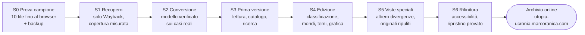

# Piano di sviluppo

Aggiornato all'11/11/2026. Analisi, modello dei contenuti e rischi sono in [analisi.md](analisi.md).

Sette sprint, da S0 a S6. Il primo dimostra che il materiale si recupera e si converte bene, su una decina di file scelti apposta, e mette in piedi repository, deploy privato e backup. Il terzo consegna già una versione utile: lettura, catalogo semplice e ricerca. Classificazione, grafica definitiva e albero delle divergenze crescono intorno a quella. Ogni sprint si chiude con una demo: si passa al successivo solo se riesce senza ritocchi.

## Roadmap



Ogni freccia si attraversa solo dopo la demo dello sprint. S1 è lungo in tempo macchina, non in lavoro: lo scaricamento gira da solo per ore mentre si prepara la conversione sui file del campione.

## Stack

All'avvio si prendono le versioni stabili più recenti (verificate su npm l'11/11/2026); da lì il lockfile di pnpm le blocca e ogni aggiornamento è deliberato, uno alla volta, con build e test. Dove basta il browser, niente librerie.

| Ambito | Scelta | Versione |
| --- | --- | --- |
| Runtime e pacchetti | Node LTS, pnpm | 24 · 12.18.0 |
| Framework | Astro, output statico, Content Collections | 7.4.10 |
| Schemi | Zod, condivisi tra conversione e sito | 4.6.7 |
| Tipi | TypeScript: il 7.0.2 è uscito ma `astro check` regge solo il 6, come in uni-portale | 6.x |
| Immagini | `astro:assets` con sharp: AVIF e WebP responsive generati in build | 0.35.5 |
| Ricerca | Pagefind, indice multilingua dopo la build | 1.6.0 |
| Caratteri | `@fontsource-variable`, in locale, nessuna richiesta a Google | 5.3.x |
| Lint e formattazione | Biome | 2.6.6 |
| Test | `node --test` per gli script, Playwright con axe per viste e accessibilità | 1.65.0 |
| Recupero | `fetch` nativo di Node, iconv-lite, cheerio, turndown | 0.7.3 · 1.2.0 · 7.2.5 |
| Deploy | Wrangler, Workers con soli asset statici | 4.160.1 |

**Piattaforma web, solo dove serve a una funzione precisa e come miglioramento progressivo:**

- View Transitions tra documenti (`@view-transition`): la scheda nel catalogo si trasforma nel titolo dell'opera.
- Animazioni legate allo scroll (`animation-timeline: view()`): i rami della linea del tempo si staccano mentre scorri.
- Popover API e anchor positioning per le note: tocchi il numero e la nota si apre accanto, senza saltare in fondo.
- Container queries, nesting nativo, colori OKLCH con `color-mix()` e `light-dark()` per i due temi.
- Script TypeScript eseguiti direttamente da Node 24, senza passaggio di build, come `agente/` in uni-portale.

Tutto rispetta `prefers-reduced-motion`: senza animazioni il sito resta completo.

## Script di recupero

Un solo comando, `pnpm recupero`, scarica dalla Wayback Machine tutte le pagine e i file (ucronie, utopie, racconti, PDF, immagini) a **lotti da 10**, con una pausa tra un lotto e l'altro, e riparte da dove si era fermato. Con le impostazioni predefinite i circa 2.640 file richiedono 4–5 ore: si lancia e si lascia girare. Il server Aruba non viene mai contattato in automatico.

**Sottocomandi** (`scripts/recupero/*.ts`, eseguiti direttamente da Node 24):

| Comando | Cosa fa | Produce |
| --- | --- | --- |
| `pnpm recupero scopri` | unisce l'indice CDX con i link trovati nelle pagine recuperate e `../racconti/`; per ogni URL elenca le copie disponibili | `archivio/coda.json` |
| `pnpm recupero scarica` | prende i prossimi 10 file dalla coda, sceglie la copia valida più recente, scarica, controlla, salva, aggiorna il manifest, aspetta | `archivio/originale/`, `archivio/manifest.json` |
| `pnpm recupero copertura` | conta gli esiti, cerca risorse richiamate e non recuperate, misura la distribuzione delle date | `archivio/copertura.md` |
| `pnpm recupero verifica` | ricalcola tutti gli hash e segnala file corrotti o mancanti | esito a terminale |
| `pnpm recupero sonda` | controllo manuale e facoltativo: una sola richiesta onesta al server originale per sapere se il blocco c'è ancora | esito a terminale |

**Opzioni di `scarica`:** `--lotto 10` (file per lotto), `--pausa 30` (secondi tra i lotti), `--attesa 2` (secondi tra due richieste, con un po' di casualità), `--max-lotti` (per provare su pochi file), `--solo <elenco>` (per il campione di S0), `--tipo html|pdf|img`, `--data-riferimento AAAAMMGG` (preferisce le copie vicine a quella data).

**Come si comporta:**

1. **Copia valida.** Per ogni URL parte dalla copia più recente e scende alle precedenti finché ne trova una valida. Non valide: pagine d'errore IIS archiviate con stato 200 ("Bot blocked", "Detailed Error"), file vuoti o troncati, tipo incoerente con l'estensione.
2. **Gzip e hash.** Riconosce il gzip non dichiarato e lo decomprime. Salva il contenuto decompresso, cioè il file com'era sul server; l'hash si calcola su quello e il manifest annota che la risposta era compressa.
3. **Esiti.** Ogni URL finisce in uno stato: `recuperato`, `recuperato da copia precedente`, `tentativo fallito` (si ripete al giro dopo), `mancante` (nessuna copia valida in nessuna data).
4. **Errori di rete.** Su 429 o 5xx rispetta `Retry-After`, altrimenti raddoppia l'attesa fino a 10 minuti. Dopo 3 tentativi l'URL resta `tentativo fallito` e si passa oltre.
5. **Ripresa.** Un file già nel manifest con hash valido non si riscarica. Con Ctrl+C il lotto in corso finisce di scrivere e il manifest resta coerente.
6. **Varianti di maiuscole.** `Dante33/x.htm` e `dante33/x.htm` sono lo stesso file: si scarica una volta e le varianti restano annotate nel manifest.
7. **Avanzamento.** A ogni lotto stampa una riga, per esempio `lotto 37/264 · 10 ok · 0 mancanti · fine stimata 21:40`, e la scrive in `archivio/registro.log`.

Nessuno script usa il server originale come sorgente in automatico.

**Sicurezza:** i file scaricati sono dati non fidati. Stanno solo in `archivio/`, gli script stanno fuori, e niente dall'archivio viene mai eseguito.

## Grafica

Da uni-portale si prende il metodo, non l'aspetto. Lì un'immagine forte e informativa (l'emiciclo, un seggio per CFU) regge tutta la home. Qui lo stesso ruolo lo ha **l'albero delle divergenze**: un ramo per ogni opera, staccato nell'anno in cui la storia cambia.

| In uni-portale | Adattato qui |
| --- | --- |
| Emiciclo da 180 seggi, uno per CFU, cliccabili | Linea del tempo dall'antichità al futuro, un ramo per opera, cliccabile; zoom con il pizzico sul telefono |
| Verde d'aula come superficie che si ricorda | Un fondo "notte del tempo", blu inchiostro profondo, sotto l'albero; il resto del sito chiaro e da lettura |
| Colori del tabellone di voto, solo per la padronanza | Colori per le epoche, sempre accanto al nome dell'epoca, mai decorativi |
| Un solo carattere, Titillium Web | Due caratteri: un serif da libro per i testi lunghi, un sans per l'interfaccia; candidati scelti nei prototipi |
| Fotografie locali delle materie | Le mappe, le bandiere e le illustrazioni originali delle opere, rimesse in risalto in una galleria |
| Metafora (seduta, seggi) solo dove informa | Metafora (rami, divergenza, "nella nostra Timeline") solo dove informa |

**I momenti spettacolari:**

- **Albero delle divergenze:** si apre sul presente; scorrendo si risale il tempo e i rami si staccano dalla linea reale uno dopo l'altro. Le epoche affollate (Roma, Novecento) diventano chiome dense.
- **Dal catalogo all'opera:** la scheda si allarga nel titolo dell'opera con una View Transition, se migliora l'orientamento.
- **Lettura:** colonna da 65–70 caratteri, capolettera all'inizio, note in popover, barra di avanzamento sottile del colore dell'epoca.
- **"E se…?":** un pulsante apre un contenuto a caso, partendo dalla sua divergenza.
- **Storia del sito:** la home del 2004 ricostruita da noi in un riquadro, con la scritta che segue il mouse, come omaggio.

L'albero è una vista in più, non la base: lettura, catalogo, ricerca e filtri funzionano da soli e arrivano prima (S3). L'albero arriva in S5, provato con dati veri e con i casi difficili.

**Metodo, come in uni-portale:** skill `frontend-design` caricata prima di toccare la grafica e cliché da evitare (fondo crema, monospazio per i dati, parola evidenziata nel titolo, etichette sopra ogni titolo, card tutte uguali). Due direzioni a confronto con contenuti veri. Collaudo a 320, 390, 768, 1024 e 1440 px, chiaro e scuro, testo al 200%, axe senza violazioni WCAG A/AA.

## Pubblicazione

Un push su `main` compila, controlla e pubblica su `utopia-ucronia.marcoranica.com`. Access va configurato **prima** del primo deploy, così il sito non è mai visibile senza login nemmeno per un minuto.

Nell’implementazione S0 il deploy richiede anche `DEPLOY_ABILITATO=true` e la verifica via API di Access. Oltre ai due segreti Cloudflare serve `ACCESS_EMAIL_PROPRIETARIO`; il token deve leggere applicazioni e policy Access. La sincronizzazione R2 si abilita separatamente con `BACKUP_R2_ABILITATO=true`. Senza queste configurazioni il workflow verifica la build e non pubblica. Dettagli nel README.

**`wrangler.jsonc`:**

```jsonc
{
  "$schema": "node_modules/wrangler/config-schema.json",
  "name": "utopia-ucronia",
  "compatibility_date": "2026-11-01",
  "assets": { "directory": "./dist", "not_found_handling": "404-page" },
  "routes": [{ "pattern": "utopia-ucronia.marcoranica.com", "custom_domain": true }],
  "workers_dev": false,
  "preview_urls": false
}
```

**`.github/workflows/deploy-sito.yml`**, ricalcato su quello di uni-portale:

1. checkout (con Git LFS), pnpm, Node 24 con cache;
2. `pnpm install --frozen-lockfile`;
3. `pnpm test` (recupero, conversione, controlli di accessibilità) e `biome ci`;
4. `pnpm build`: conversione, `astro check`, build, indice Pagefind;
5. controllo dei link su `dist/`: un link irrisolto senza spiegazione blocca il deploy;
6. `wrangler deploy`, solo se i segreti ci sono, altrimenti un avviso e la build resta verificata;
7. se `archivio/` è cambiato, sincronizzazione sul bucket R2 di backup.

Sul ramo di una pull request si fanno i passi 1–5 senza deploy.

**Da fare a mano una volta (io):**

- [ ] Creare il repository privato `utopia-ucronia` su GitHub, con Git LFS attivo.
- [ ] Aggiungere i segreti `CLOUDFLARE_API_TOKEN` e `CLOUDFLARE_ACCOUNT_ID`; verificare che il token di uni-portale valga per tutti i Worker dell'account e per R2, altrimenti crearne uno nuovo.
- [ ] Creare il bucket R2 `utopia-ucronia-archivio` per il backup.
- [ ] In Cloudflare Zero Trust verificare l'applicazione Access per `utopia-ucronia.marcoranica.com`, policy con i tre indirizzi scelti dal proprietario, sessione 30 giorni.
- [ ] Scegliere il disco per la terza copia.
- [ ] Dopo il primo deploy, aprire il sottodominio da una finestra anonima e verificare che chieda il login.

## Sprint

### S0 · Prova sul campione e fondamenta

- [x] Campione di 11 file: home, Lista e frame di testo, opera lunga e collettiva, opera spezzata in due file, sottocartella francese, tre immagini e un PDF
- [x] `recupero scarica --solo` sul campione: validazione, gzip, hash, esiti; rilancio senza nuovi download
- [x] Prima conversione del campione e pagina Astro minima che lo mostra (6 documenti testuali, frameset escluso dalla lettura)
- [x] Confronto automatico integrale di testo, accenti, ancore e tabelle; immagini mancanti registrate, PDF escluso dall’output in attesa di verifica
- [x] Confronto visivo nel browser desktop e mobile emulato, accenti, ancore e attribuzioni conservate nel testo; axe A/AA senza violazioni, larghezze 320–1440 px e testo al 200%
- [x] `git init`, collegamento al repository indicato, Git LFS, Astro 7 statico, pnpm 12, Biome, TypeScript 6, `node --test`
- [x] `wrangler.jsonc`, workflow con deploy disabilitato finché Access non è verificato via API, deploy simulato riuscito
- [x] Applicazione Access, tre indirizzi autorizzati, segreti GitHub, primo deploy e verifica del reindirizzamento anonimo al login
- [x] Script di backup esportabile con verifica degli hash e script di prova del ripristino da cartella
- [x] Ripristino da clone pulito riuscito: 11 file ricostruiti soltanto dal backup, hash verificati, dipendenze reinstallate e build completa superata
- [x] Percorso `ripristino:prova --r2` implementato e verificato con oggetti simulati: copia integra, file corrotto e percorso non sicuro
- [x] Bucket R2 creato, campione caricato e ripristino dal bucket reale verificato in un clone pulito
- [x] Sincronizzazione automatica R2 dalla GitHub Action configurata e collaudata
- [x] Demo da telefono fisico: il proprietario conferma accesso e visualizzazione del campione; la grafica provvisoria sarà rivista nelle epiche successive
- [ ] Copia del backup sul drive del proprietario (rinviata dal proprietario a sua cura; non blocca lo sviluppo)

Dettagli, limiti e configurazione: [stato-s0.md](stato-s0.md) e [README](../README.md). Le rimozioni di dati personali e codice attivo non modificano mai gli originali. In S0 la conversione resta una prova per documento; unione e divisione editoriali appartengono a S2.

Demo: dal telefono, dietro login, leggo i contenuti del campione convertiti; il ripristino da un clone pulito riesce.

### S1 · Recupero

- [ ] `recupero scopri`: coda da CDX e da scansione dei link, con le copie disponibili per ogni URL
- [ ] Test degli script su risposte registrate, senza rete: pagine d'errore, gzip, file troncati
- [ ] `recupero scarica` completo in background, a lotti da 10
- [ ] `recupero copertura` e ricerca a mano dei buchi su altri archivi
- [ ] Scelta della data di riferimento per `/originale/`

Demo: `archivio/copertura.md` con le percentuali per tipo; rilanciare `scarica` non scarica nulla; `recupero verifica` senza errori.

### S2 · Conversione

- [ ] Schema Zod di documenti, contenuti, contributi, autori, epoche, luoghi, temi
- [ ] Agente che propone la mappa di riorganizzazione (`contenuti/mappa.yaml`): azione, livello e metadati, ognuno con motivazione
- [ ] Estrazione delle divergenze dalla Lista delle ucronie e dei contributi dalle pagine collettive
- [ ] `converti`: codifica, pulizia FrontPage, Markdown (HTML ripulito dove serve), unione e divisione, link e ancore riscritti, email tolte, immagini unificate
- [ ] Correzioni manuali in `contenuti/correzioni/`
- [ ] Controllo dei link: ogni link irrisolto è spiegato, come errore da correggere o lacuna dell'archivio
- [ ] Prime verifiche di accessibilità sui componenti di lettura

Demo: schema senza errori; zero link irrisolti senza spiegazione; lista di confronto superata su 30 contenuti scelti a caso.

### S3 · Prima versione utile

- [ ] Pagina di lettura: testo, note, allegati, immagini, contributi con autore, link alla pagina d'origine
- [ ] Catalogo semplice: titoli, autori e filtri su ciò che c'è, anche con metadati parziali
- [ ] Ricerca Pagefind sulla nuova edizione, con scorciatoia `/`
- [ ] Pagina `/revisione`, solo in sviluppo, per rivedere la mappa a blocchi di 20
- [ ] Uso da tastiera e lettura da telefono verificati

Demo: dal telefono ritrovo un'opera ricordandone solo una frase, e da lì apro la sua pagina d'origine.

### S4 · Edizione completa

- [ ] Revisione progressiva della mappa: prima mondi e pagine da dividere o unire
- [ ] Epoche fissate ed elenco dei temi chiuso
- [ ] Pagine di mondi, autori, epoche, luoghi e temi; filtro per lingua
- [ ] Due direzioni grafiche su lettura e catalogo, con contenuti veri; scelta e `tokens.css`
- [ ] View Transitions tra catalogo e lettura, se migliorano l'orientamento

Demo: la direzione scelta, da telefono e da desktop, in chiaro e in scuro; i filtri funzionano anche sui contenuti non ancora rivisti.

### S5 · Viste speciali

- [ ] Albero delle divergenze, provato con i casi difficili: date mancanti, titoli lunghi, secoli affollati, telefono
- [ ] Copia consultabile in `/originale/`: pulizia, link interni, Content Security Policy senza script, email tolte
- [ ] Storia del sito, con la home del 2004 ricostruita da noi
- [ ] "E se…?": un contenuto a caso

Demo: dall'albero a un'opera del Novecento e alla sua pagina originale ripulita, senza nessuno script del 2004 in esecuzione.

### S6 · Rifinitura

- [ ] Playwright e axe su tutte le viste, larghezze da 320 a 1440 px, testo al 200%
- [ ] Lighthouse come indicatore, non come obiettivo
- [ ] Nuova prova di ripristino da zero
- [ ] README e `CLAUDE.md` aggiornati

Demo: giro completo dal telefono senza ritocchi; ripristino da zero riuscito.
